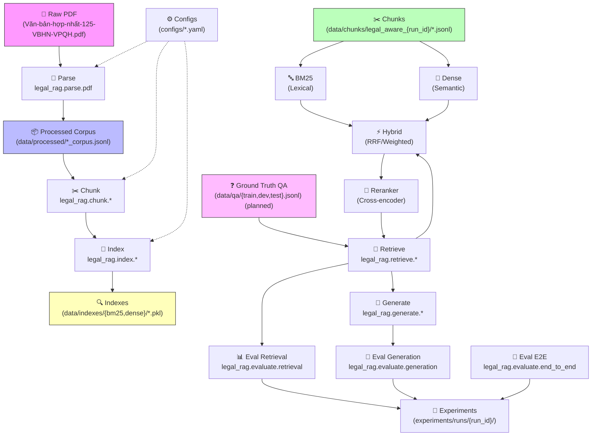
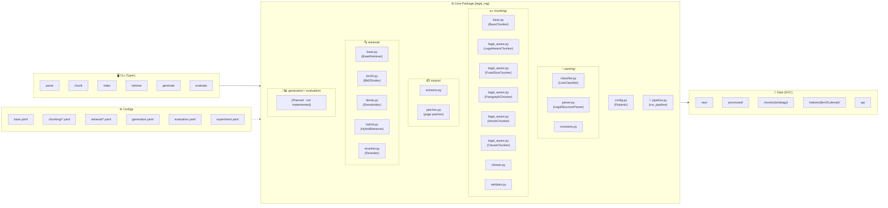
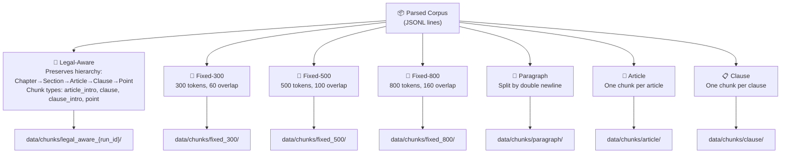
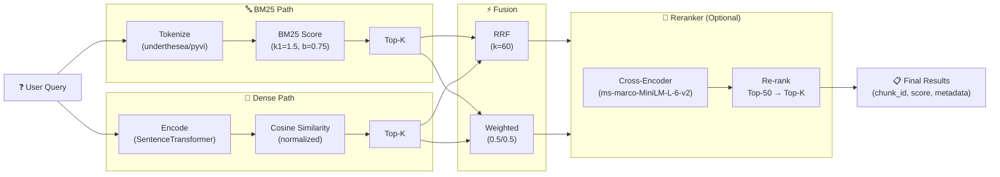
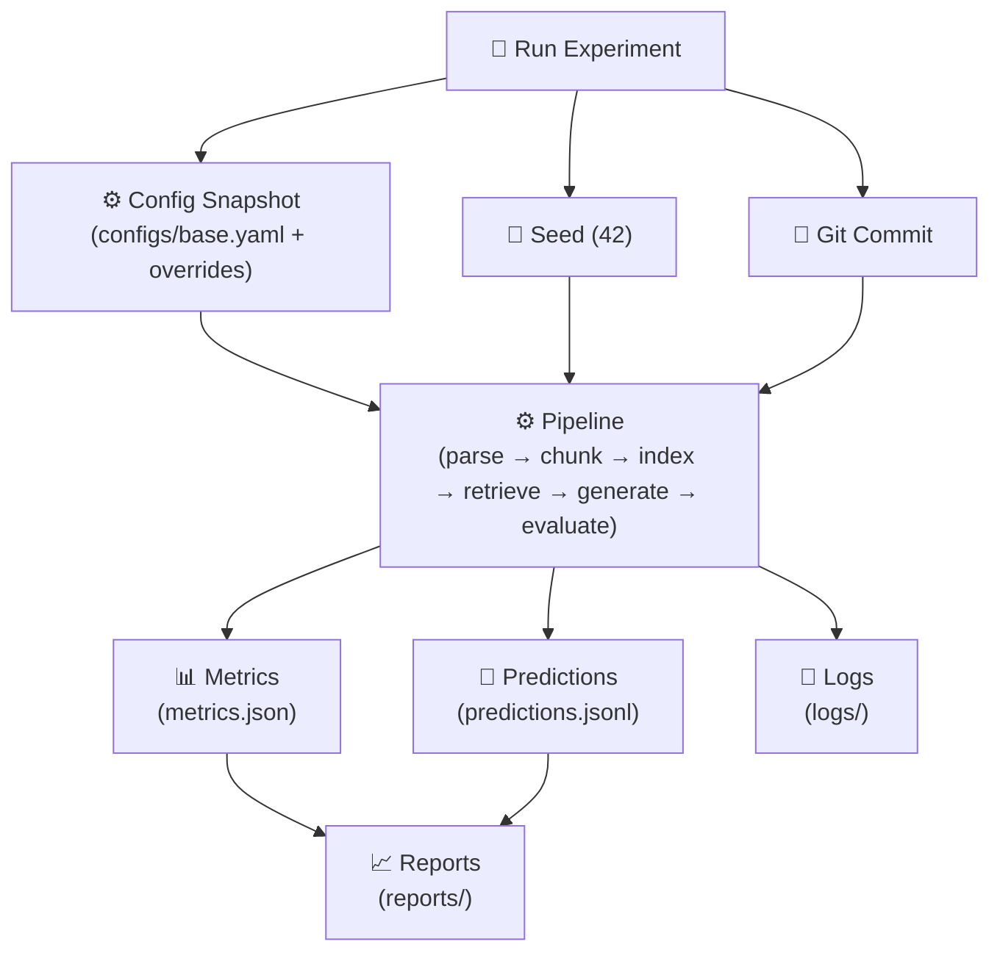

# Legal RAG Architecture

## High-Level Data Flow



## Module Architecture



## Chunking Strategies Comparison



## Retrieval Pipeline



## Experiment Tracking



## Directory Structure

```
LegalRAG/
├── configs/                          # Configuration (YAML)
│   ├── base.yaml                     # Main config
│   ├── chunking/                     # Chunking strategies
│   ├── retrieval/                    # Retrieval configs
│   ├── generation.yaml               # Generation config
│   ├── evaluation.yaml               # Evaluation config
│   └── experiment.yaml               # Experiment tracking
├── data/                             # Data (run outputs are git-ignored)
│   ├── raw/                          # Source PDFs (read-only)
│   ├── ocr/                          # OCR evidence + page patches
│   │   ├── patches/                  # JSON page patches (page-86 fix)
│   │   └── renders/                  # Verification renders (local, ignored)
│   ├── processed/                    # Parsed corpus per run (JSONL)
│   ├── chunks/                       # legal_aware_<run_id>/ (pipeline); baselines on demand
│   ├── indexes/                      # Retrieval indexes (generated)
│   └── qa/                           # Ground truth (planned, frozen)
├── src/
│   └── legal_rag/                    # Installable package
│       ├── config.py                 # Pydantic config management
│       ├── parsing/                  # PDF parsing & legal structure
│       ├── chunking/                 # 5 chunking strategies
│       ├── corpus/                   # Corpus extraction + page patches
│       ├── retrieval/                # BM25, Dense, Hybrid, Reranker
│       ├── pipeline.py               # Standard end-to-end build
│       ├── generation/               # LLM answer generation (planned)
│       ├── evaluation/               # Metrics & evaluation (planned)
│       └── cli/                      # Typer CLI commands
├── tests/                            # Unit & integration tests
│   ├── unit/                         # Unit tests
│   └── integration/
├── notebooks/                        # EDA & analysis
├── reports/                          # Decision logs / generated reports
├── experiments/                      # Experiment outputs (auto-generated, planned)
├── pyproject.toml                    # Package config
├── requirements.txt                  # Production deps
├── requirements-dev.txt              # Dev deps
├── README.md
├── ARCHITECTURE.md
└── AGENTS.md                         # Project rules
```

## Key Design Principles

| Principle | Implementation |
|-----------|----------------|
| **Reproducibility** | Config snapshots, git commit, seed, frozen test set |
| **Fair Comparison** | Same corpus, same queries, same k, only chunking strategy varies |
| **Legal Structure Preservation** | Legal-aware chunking keeps Chapter→Section→Article→Clause→Point |
| **Traceability** | Every chunk links to document_id, page, article, clause, point |
| **No Data Leakage** | Gold labels never in index/prompt; train/dev/test split |
| **Modular Config** | Override single component via YAML without code changes |
| **Type Safety** | Pydantic config validation, typed interfaces |
| **Testability** | Abstract base classes, unit tests for each module |