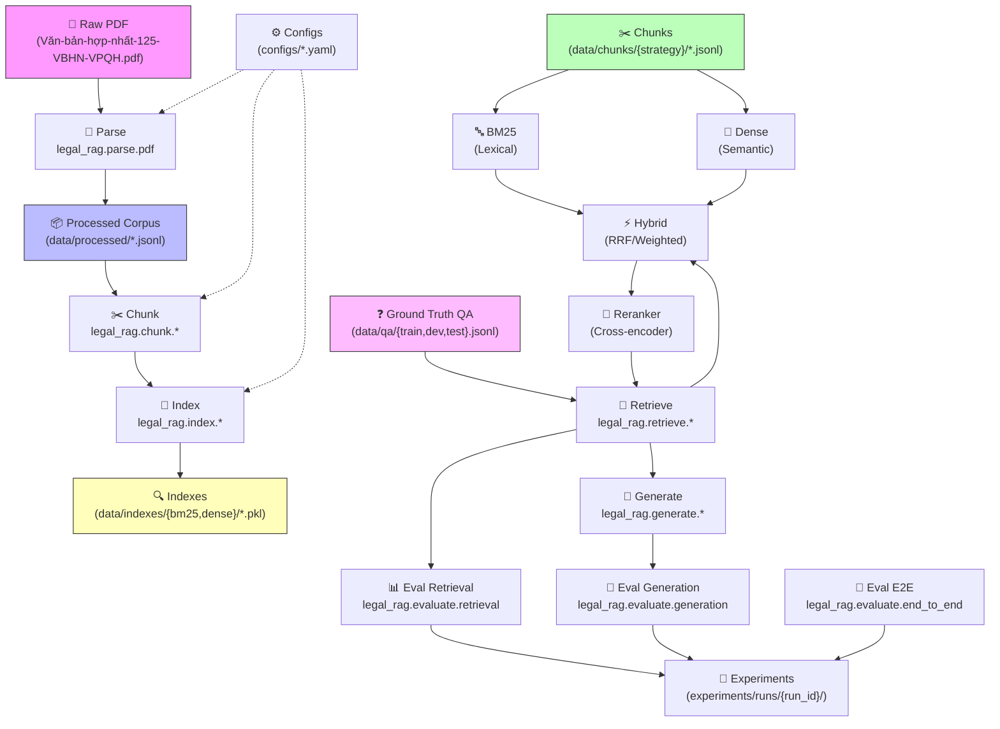
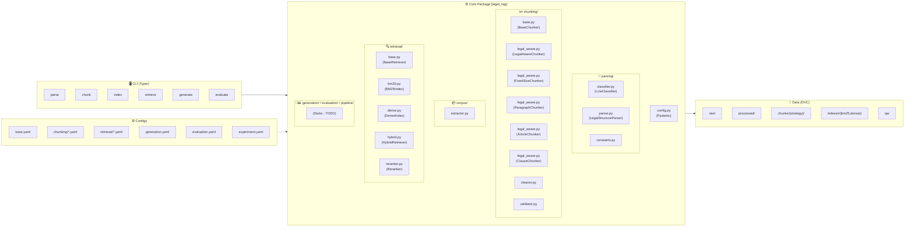
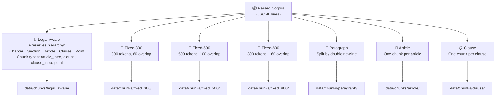
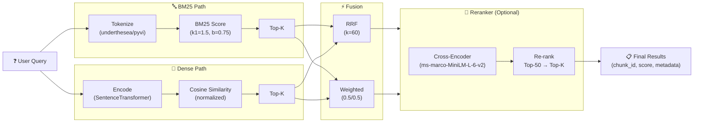
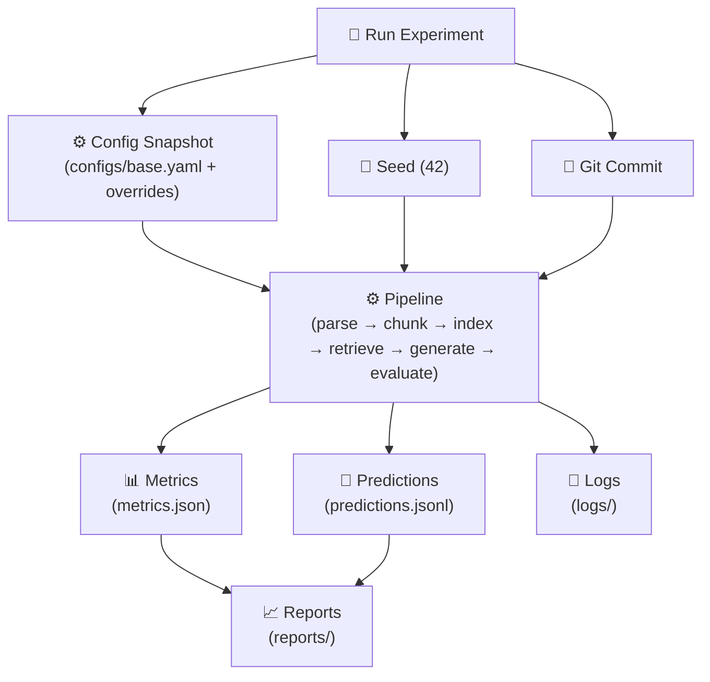

# Legal RAG Architecture

## High-Level Data Flow



## Module Architecture



## Chunking Strategies Comparison



## Retrieval Pipeline



## Experiment Tracking



## Directory Structure

```
LegalRAG/
├── configs/                          # Configuration (YAML)
│   ├── base.yaml                     # Main config
│   ├── chunking/                     # Chunking strategies
│   ├── retrieval/                    # Retrieval configs
│   ├── generation.yaml               # Generation config
│   ├── evaluation.yaml               # Evaluation config
│   └── experiment.yaml               # Experiment tracking
├── data/                             # Data (DVC versioned)
│   ├── raw/                          # Original PDF (read-only)
│   ├── processed/                    # Parsed corpus (JSONL)
│   ├── chunks/                       # By strategy
│   │   ├── legal_aware/              # Legal-aware (proposed)
│   │   ├── fixed_300/500/800/        # Fixed-size baselines
│   │   ├── paragraph/                # Paragraph baseline
│   │   ├── article/                  # Article baseline
│   │   └── clause/                   # Clause baseline
│   ├── indexes/                      # Retrieval indexes
│   │   ├── bm25/                     # BM25 indexes
│   │   └── dense/                    # Dense vector indexes
│   └── qa/                           # Ground truth (frozen)
│       ├── train.jsonl
│       ├── dev.jsonl
│       └── test.jsonl
├── src/
│   └── legal_rag/                    # Installable package
│       ├── config.py                 # Pydantic config management
│       ├── parsing/                  # PDF parsing & legal structure
│       ├── chunking/                 # 5 chunking strategies
│       ├── corpus/                   # Corpus extraction
│       ├── retrieval/                # BM25, Dense, Hybrid, Reranker
│       ├── generation/               # LLM answer generation (stub)
│       ├── evaluation/               # Metrics & evaluation (stub)
│       ├── pipeline/                 # End-to-end pipelines (stub)
│       ├── utils/                    # Utilities
│       └── cli/                      # Typer CLI commands
├── scripts/                          # One-off scripts
├── experiments/                      # Experiment outputs
│   └── runs/
│       └── {run_id}/
│           ├── config_snapshot.yaml
│           ├── metrics.json
│           ├── predictions.jsonl
│           └── logs/
├── tests/                            # Unit & integration tests
│   ├── unit/                         # 39 passing tests
│   ├── integration/
│   └── fixtures/
├── notebooks/                        # EDA & analysis
├── pyproject.toml                    # Package config
├── requirements.txt                  # Production deps
├── requirements-dev.txt              # Dev deps
├── README.md
├── AGENTS.md                         # Project rules
└── .pre-commit-config.yaml
```

## Key Design Principles

| Principle | Implementation |
|-----------|----------------|
| **Reproducibility** | Config snapshots, git commit, seed, frozen test set |
| **Fair Comparison** | Same corpus, same queries, same k, only chunking strategy varies |
| **Legal Structure Preservation** | Legal-aware chunking keeps Chapter→Section→Article→Clause→Point |
| **Traceability** | Every chunk links to document_id, page, article, clause, point |
| **No Data Leakage** | Gold labels never in index/prompt; train/dev/test split |
| **Modular Config** | Override single component via YAML without code changes |
| **Type Safety** | Pydantic config validation, typed interfaces |
| **Testability** | Abstract base classes, unit tests for each module |